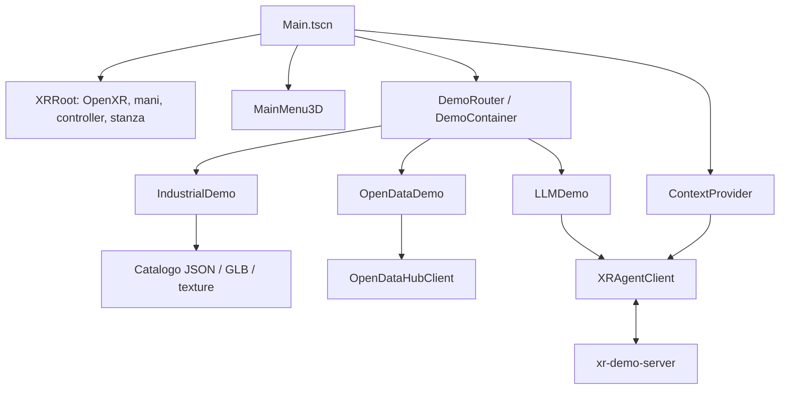
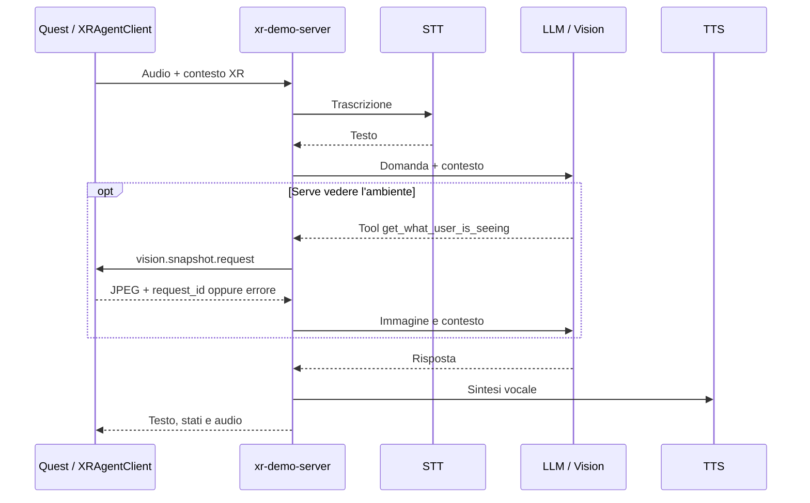

# Architettura e modifiche da editor

Riferimento per la base Novembre, derivata dalla versione fissata di ottobre.
Le tre demo condividono XR, UI e servizi; ciascuna possiede il proprio scenario.

`Main` coordina ingresso, menu e caricamento. `DemoRouter` carica e rimuove la
scena selezionata. `ContextProvider` espone demo attiva, prodotto e stanza al
client AI. Un solo `XROrigin3D`/`XRCamera3D` vive in `XRRoot`: non duplicarlo
nelle demo. UI riutilizzabile in `scenes/ui`, servizi in `scenes/services`,
logica tecnica nei corrispondenti script.

## Dove modificare

| Scena o risorsa | Responsabilità e parametri utili |
| --- | --- |
| `scenes/app/Main.tscn` | Composizione app, menu, caricamento globale e illuminazione. |
| `scenes/xr/XRRoot.tscn` | Passthrough, Scene API, spatial anchor, mani/controller e puntatori di entrambe le mani. |
| `scenes/ui/MainMenu3D.tscn` | Schede delle tre demo, testo, immagini e barra inferiore di trascinamento. |
| `scenes/ui/ExperienceCard3D.tscn` | Scheda del menu principale, ereditata da `DemoButton3D`: cornice Blender, preview e indicatore di puntamento. |
| `scenes/demos/industrial/IndustrialDemo.tscn` | Viewer, pannello informativo, controller di posa/rotazione/caricamento e istanza `WristMenu3D`. |
| `scenes/demos/industrial/IndustrialCatalogPanel.tscn` | Catalogo effettivo della demo industriale: filtri, schede, controlli e barra di spostamento. Il nome storico `WristMenu3D` non significa che il pannello debba seguire il polso. |
| `scenes/ui/WristMenuModelSlot3D.tscn` | Scheda prodotto, miniatura, etichette e area selezionabile. |
| `scenes/ui/DemoButton3D.tscn` | Pulsante comune e area di interazione. |
| `scenes/ui/CatalogActionButton3D.tscn` | Variante con etichetta grande su una riga per i comandi e i filtri industriali. Riusa il pulsante comune e le sue interazioni. |
| `scripts/ui/info_panel_3d.gd` | Pannello informazioni comune: viene composto inline nelle scene demo (industriale, opendata), non istanziato da un .tscn dedicato; l'istanza industriale contiene righe descrittive, Menu e X. |
| `assets/materials/ui/*.tres` | Aspetto condiviso di pannelli e pulsanti. |
| `scenes/demos/opendata/OpenDataDemo.tscn` | Mappa, pannelli, marcatori e controller del layout. |
| `scenes/demos/llm/LLMDemo.tscn` | Assistente, cattura camera e richiesta di snapshot. |
| `scenes/demos/llm/VoiceAssistantPanel.tscn` | Layout e `StatusProfiles` di testo, badge, colori e orb. |
| `scenes/services/XRAgentClient.tscn` | URL WebSocket, rilevamento voce, silenzio, guadagno e interruzione della risposta. |

Modificare layout, testi, risorse e parametri esposti nell'Inspector. HTTP,
WebSocket, audio, ciclo di vita XR e calcoli di posa restano codice. Mantenere i
riferimenti ai nodi quando si riorganizza una scena; evitare trasformazioni
imposte ogni frame che annullino quelle dell'editor. Verificare anche l'APK:
le scene esportate possono avere override diversi da quelli attesi nell'editor.

## Interazioni condivise e stanza

OpenXR gestisce sessione e azioni comuni. Passthrough, camera, stanza e anchor
qui usano estensioni/plugin Meta: non sono una promessa di portabilità completa
su PICO o altri visori. La collaborazione multiutente sperimentale non fa parte
di questa suite congelata; il solo uso di OpenXR non la rende standard OpenXR.

I due puntatori e il tocco usano controlli condivisi. L'area cliccabile deve
coprire tutta la parte visibile della scheda; nascondere un pannello disabilita
anche le sue collisioni interattive. La presa verifica tracking e pinch nativo:
un pugno chiuso non deve bastare. I parametri fisici restano regolabili perché
qualità della scansione, distanze e tracking cambiano fra ambienti.

La geometria della stanza è invisibile e collidibile sul layer dedicato
`xr-room-surfaces`, separato dalla selezione UI. Le superfici vengono abilitate
dopo tracking stabile; pose e cambio del riferimento XR richiedono aggiornamenti.
Se mancano dati di pavimento viene indicato **Pavimento stimato**. Nessuna scansione
significa nessuna garanzia sulle pareti; non esiste un pulsante di scansione
visibile nell'attuale flusso della demo.

Menu principale e catalogo si spostano con pinch immediato sulla barra inferiore.
Restano liberi nella stanza e diritti rispetto alla persona; vicino a una parete
possono allinearsi al muro. Non devono essere obbligati a stare sulle pareti.

## Catalogo industriale

`IndustrialCatalog` legge `data/industrial_models.json`.
`IndustrialModelLoader` carica risorse in background; il viewer istanzia i nodi
nel thread principale e collega bounds, animazioni e punti informativi.
Il controller di caricamento gestisce attesa e annullamento.

| Passaggio | Comportamento previsto |
| --- | --- |
| Scegliere un arredo | Rilascio del pinch di selezione, poi anteprima trasparente spostabile. |
| Posare | Un nuovo pinch fissa il fantasma; il rilascio conferma. |
| Riprendere | Pinch mantenuto per **1 s** su qualsiasi punto dell'ingombro dell'oggetto. |
| Avvicinare/allontanare | Presa diretta 1:1; a distanza interviene il guadagno di profondità configurato. |
| Ruotare | Due pinch simultanei, senza incrementi imposti da un pulsante. |
| Pareti | Posa libera; allineamento opzionale vicino al muro per `wall_snap`, vincoli su ingombro e angoli quando la stanza è disponibile. |
| Informazioni | Scheda inizialmente a lato; la posa manuale resta passando fra punti info, chiudendo e riaprendo. Punti selezionabili fuori dall'ingombro, collegati al componente. X chiude e deseleziona il pannello. |
| Copie | Fino a otto arredi nella sessione, con animazioni e selezione indipendenti. |

I dettagli leggibili sono descrizione, categoria e quattro righe di `details`.
La scheda compensa la distanza di lettura da 2,5 m fino a un fattore 3, senza
cambiare la scala del prodotto. I punti info vengono separati quando si
sovrappongono nella vista corrente. Perdita di tracking e gesti annullati non
devono produrre conferme o prese tardive: provare i casi in collaudo (guida interna).

Il modello iniziale parte dopo tre frame. Dopo 150 ms di pagina stabile si
precaricano le tre schede visibili; LRU di massimo quattro PackedScene.
Il vecchio flag JSON `preload` non governa questa strategia. Un caricamento
annullato non può ripresentare il fantasma; spostare un arredo già posato
trasferisce i nodi esistenti senza ricaricare il GLB.

## Open Data Hub / Digital Twin

Novembre usa la ricostruzione Blender del campus: 14 edifici selezionabili,
46 piani separati e selezione delle superfici degli ambienti. È una ricostruzione
pubblica, non un BIM ufficiale. `NoiMap3D` carica prima `campus_ghost.glb` in un
thread; `Colori` richiede il campus con materiali, aprire un piano carica solo
quel livello e nasconde gli esterni. Tornare al campus rilascia il piano.
Le geometrie e i limiti della fonte sono descritti in [assets.md](assets.md).
`OpenDataLayoutController` riusa `XRModelRotationController3D`: pinch di un secondo
per spostare il plastico, due pinch per ruotarlo e variare la scala: separare le
mani ingrandisce, avvicinarle riduce (0,5–2×). La perdita breve di tracciamento
ricalibra la distanza tra le mani, evitando salti al recupero. La presa diretta segue la mano;
a distanza il suo avvicinamento/allontanamento regola la profondità. Una perdita
prolungata di tracciamento annulla lo spostamento. Il pinch breve sugli edifici
seleziona al rilascio, evitando di cambiare selezione durante una presa.
Sorgenti e impostazioni sono nel pannello dati laterale, indipendente dal plastico.
La maniglia condivisa sposta subito menu principale, catalogo, dati, introduzione,
schede informative e assistente. Le schede industriali spostate manualmente
mantengono la posa anche cambiando dettaglio. Ripristina riporta anche la scala a 1×.
Le etichette del plastico ruotano gradualmente sul proprio asse verticale verso
la posizione della testa: la sola rotazione del visore non le trascina.
Titolo e testo del punto mantengono la dimensione fisica durante lo zoom;
l'etichetta selezionata resta 10 cm sopra l'indicatore.

`OpenDataHubClient` interroga soltanto le due stazioni indoor di Bolzano ogni
10 secondi, con timeout di 8 secondi. Accetta temperatura, umidità e CO₂ numeriche,
finite, nell'unità prevista, con data UTC/offset valida. Una misura deve avere
**meno di 300 secondi**; il limite ammette due cicli dei sensori da 120 secondi
più 60 secondi di margine. Date future oltre 30 secondi sono scartate. Il limite
è configurabile nel client (massimo Inspector 300 s), non esteso dall'API.

Ogni misura conserva la propria scadenza UTC e monotona. La scadenza viene
controllata ogni frame e prima di costruire il contesto dell'assistente;
ricevere nuovamente la stessa misura non ne rinnova la durata. Risposte vuote,
misure mancanti ed errori eliminano i valori precedenti. HTTP 200 e `sactive`
non significano “live”. Pannello, indicatore verde e AI usano lo stesso snapshot;
una temperatura recente non può rendere recente una CO₂ vecchia. Il badge è
relativo alla selezione, con stato parziale quando mancano singole misure.

Entrambe le sorgenti sono localizzate al piano 1 di A1. I POI `NOI-Place`
identificano il Free Software Lab, ma non collegano univocamente il sensore a
una superficie del modello: il verde indica disponibilità **al piano**, non
misure in tutte le stanze. Le zone selezionabili senza associazione mostrano
“Nessun sensore associato”; il blu indica selezione, non dati live. Nessun
valore simulato viene usato quando il servizio è indisponibile.

Selezionare una sorgente conserva campus/piano e inquadratura. Il contorno
azzurro è un volume di navigazione: per il Lab usa la porzione `A1-1-33-B`
ricostruita dalla pianta pubblica, coerente con i POI A/B; la porzione A non ha
un poligono disponibile. Per la qualità aria A1 contorna tutto il piano 1,
unico ambito noto. Non sono associazioni sensore-stanza. Il marcatore si sposta
con la selezione e diventa verde solo con misure recenti; alla scadenza torna
neutro mantenendo la posizione. Una sorgente fuori dal piano aperto non viene
disegnata in una stanza sbagliata: tornare al campus per localizzarla.

### Ricerca dati pubblici — aggiornata il 17 settembre 2026

Verificate le categorie della [Time Series API](https://mobility.api.opendatahub.com/v2/flat,node/),
le stazioni per nome/origine e quelle nel riquadro 11.327–11.338 E,
46.473–46.483 N (campus e immediati dintorni). La ricerca nei dintorni non
attribuisce automaticamente quelle stazioni al NOI. Sintassi e significato di
`latest` dalla [documentazione del gestore](https://github.com/noi-techpark/opendatahub-timeseries-api).
Ricontrollo del 17 settembre fra 21:00 e 21:08 UTC, con storico delle ultime
due ore per parcheggio e car sharing. Esiti osservati, non garanzie di continuità:

| Fonte | Riscontro | Decisione per la demo |
| --- | --- | --- |
| [IndoorStation, origine NOI](https://mobility.api.opendatahub.com/v2/flat,node/IndoorStation/*/latest?where=sorigin.eq.NOI&limit=100&shownull=true) | Due stazioni Bolzano, cinque canali ambientali aggiornati ogni 120 s. Anche `battery-state-percent` è recente (entrambi riportano 1%): diagnostica, non nuove stanze. Vecchi `battery-state` e `co2` fermi al 2025; Brunico escluso. | Integrati solo i cinque canali ambientali attuali di Bolzano, sempre con verifica d'età. |
| [NOI-Place, Free Software Lab](https://mobility.api.opendatahub.com/v2/flat,node/NOI-Place?where=scode.in.%28A11.33.A,A11.33.B%29&limit=20) | Piano, etichette e coordinate statiche dei locali. Altre voci storiche/duplicate non sono sensori. | Fonte della localizzazione al piano; nessuna copertura live inventata nelle stanze. |
| [Parcheggio NOI](https://mobility.api.opendatahub.com/v2/flat,node/ParkingStation/*/latest?where=scode.eq.urn%3Aparking%3Askidata%3Af383171a-0ec4-5371-b4f6-8ba7b866a55d&limit=100) | 245 posti; `free`/`occupied` aggiornati alle 21:03:04 UTC, 44 s prima della seconda lettura. `mperiod=600`, ma lo storico mostra intervalli fra 7 s e 15 min: non è un heartbeat garantito ogni 10 min. Previsioni e sottocategorie sono serie diverse. | Buon candidato per un punto esterno del campus, con timestamp e scadenza rigorosa: nessun valore oltre soglia presentato come live. |
| [Bikesharing NOI](https://mobility.api.opendatahub.com/v2/flat,node/BikesharingStation/*/latest?where=sname.eq.%22NOI%20Techpark%20Alto%20Adige%22&limit=100) | Bici/stalli aggiornati alle 21:00 UTC, periodo dichiarato 300 s; stato ancora `OUT_OF_SERVICE`. | Eventuale contesto mobilità, non dato ambientale delle stanze; rispettare lo stato di servizio. |
| [Carsharing NOI, AlpsGo](https://mobility.api.opendatahub.com/v2/flat,node/CarsharingStation/*/latest?where=scode.eq.%221092945197%22&limit=100) | Disponibilità AlpsGo: 2 auto alla lettura, timestamp passato da 21:00:17 a 21:05:11 UTC nel ricontrollo. Lo storico conferma circa 5 min tra campioni; la stazione omonima `406603` è ferma al 2024. | Candidato più regolare per un piccolo punto mobilità esterno; controllare età del singolo campione, senza dedurre occupazione delle stanze. |
| [Bicibox A1 e B1/A2](https://mobility.api.opendatahub.com/v2/flat,node/BikeParking/*/latest?where=scode.in.%28%222184%22,%222185%22%29&limit=100) | Due gruppi da 5 posti, indirizzi NOI espliciti nei metadati; dati 21:00:30 UTC, periodo 600 s. A1: stato aggregato `unknown`, 4 liberi; B1/A2: aggregato `out of service`, benché i singoli box risultino `in service`. | Dato interessante, da chiarire con il fornitore: non convertire conteggi recenti in una falsa disponibilità del servizio. |
| Ricarica via Volta | Vecchi ID rimossi e nuovi Neogy-AMPECO: gli ultimi stati delle prese Volta risalgono alle 16:00–19:08 UTC. Nessun heartbeat recente verificato; `mperiod=1` non prova aggiornamenti al secondo. | Non presentare l'ultima variazione come conferma live. |
| Meteo/ambiente dei dintorni | Siemens/Luis Braille: soprattutto idrometria e temperatura acqua, anche record storici; nessun nuovo sensore ambientale di stanza NOI verificato. | Esclusi da questo Digital Twin. |
| [PV Integration Lab](https://noi.bz.it/it/laboratori/pv-integration-lab), [Energy Exchange Lab](https://noi.bz.it/it/laboratori/energy-exchange-lab) | Monitoraggio documentato, ma nessun endpoint pubblico live utilizzabile verificato nella ricerca. | Chiedere a NOI/Eurac accesso e associazioni spaziali prima di integrare energia/impianti. |

Le risposte e gli URL esatti della ricognizione sono conservati localmente in
`build/digital-twin/research/` e `build/studio-dev21/research/`, esclusi da Git.
Le altre fonti sono proposte,
non nuovi flussi aggiunti automaticamente alla demo.

## Assistente: client, server e tool

Questo è il flusso del provider locale. `ContextProvider.build_context()`
trasmette scenario/oggetto/stanza attivi. Il Quest cattura audio mono Float32
48 kHz, chiude il turno dopo il silenzio e riproduce la risposta; il barge-in
consente l'interruzione. `LLMSnapshotController` coordina una singola immagine
su richiesta tramite `PassthroughCameraCapture`; la preparazione del frame è
spostata fuori dal ciclo grafico. Non implica analisi continua della camera.

NoiBot (ex Milo) è un componente opzionale di `LLMDemo`: `AssistantRobot` carica il GLB
solo su richiesta e riusa `IndustrialModelPlacementController` per posa,
presa di 1 s e rotazione a due mani. Il rig aggiorna anche l’ingombro della
presa durante i gesti. `NoiBotController` segue il player di `XRAgentClient`;
il proxy, quando richiesto, allega cue Rhubarb all’audio TTS completato.
Rimozione dell’avatar e interruzione della voce restano operazioni distinte.

Decisione del tool, prompt e provider vivono nel server. Il client si connette
solo al proxy. Per configurazione, TLS, Google alternativo, protocollo ed errori
seguire il [README del server](../../xr-demo-server/README.md).
`VideoFrameStreamer`, QR e provider alternativi restano sperimentazioni da
validare esplicitamente; non confonderli con l'audio locale/demo 4 dell'altro branch.

## Riuso nella formazione

Il materiale può sostenere un'orientation dimostrativa e successivi laboratori:
scene/UI, integrazione di un prodotto e dati ODH, infine voce/visione ed export.
Sono possibili moduli da circa due ore, da concordare con NOI. Non sono corsi
consegnati né nuove funzionalità promesse. Diagrammi, sorgenti degli asset e
percorso di prova (guida interna) sono i riferimenti riutilizzabili.
